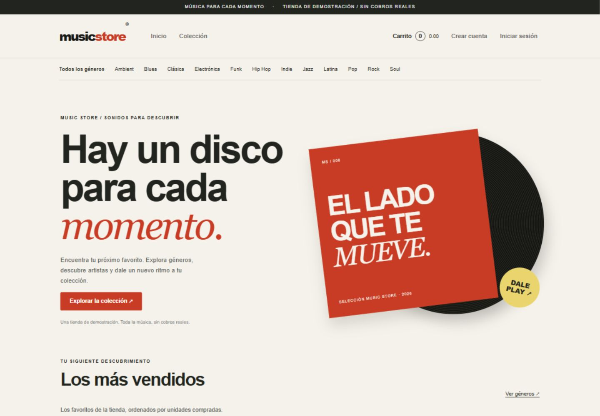

# Music Store

Tienda académica ASP.NET MVC 5 sobre .NET Framework 4.8, Razor, EF6, SQL Server e Identity. Permite explorar álbumes, administrar el catálogo, conservar carritos por cuenta y guardar pedidos de demostración. No procesa pagos reales; checkout usa el código `FREE`.

## Abrir y ejecutar en Windows

1. Instalar Visual Studio con Desarrollo de ASP.NET y web, .NET Framework 4.8 e IIS Express, y SQL Server Express.
2. Abrir `MusicStore.slnx` desde Visual Studio. Restaurar los paquetes NuGet de la solución si faltan.
3. En `MusicStore/Web.config`, configurar las conexiones `MusicStoreEntities` y `AccountsConnection` para la instancia local. La instalación actual usa `.\SQLEXPRESS`, bases `MusicStore` y `MusicStoreAccounts`, con autenticación integrada de Windows.
4. Conservar respaldos antes de cambiar esquema o datos. En una instalación nueva, crear/aplicar las migraciones del catálogo desde la Consola del Administrador de paquetes (`Update-Database` con el proyecto MusicStore seleccionado). Preparar Identity y el aprovisionamiento inicial siguiendo `docs/sprint-5.md`; la auditoría administrativa se prepara con `tools/Prepare-AdminAudit.sql`. No ejecutar inicializadores que eliminen bases existentes.
5. Ejecutar con **Ctrl+F5** para la demo, o F5 para depurar. La URL actual es `http://localhost:54834/`; el puerto depende de IIS Express en cada equipo.
6. Registrar una cuenta normal desde la aplicación. Para aprovisionar al primer administrador, consultar `tools/AccountsAdmin.ps1` y `docs/ampliacion-administrativa.md`. Las contraseñas se introducen en la aplicación y no se guardan en Git.

## Catálogo de demostración

`pwsh -NoProfile -File tools/Import-DemoCatalog.ps1` agrega 36 álbumes ficticios con portadas SVG originales, 12 artistas y hasta 12 géneros. Primero respalda y verifica ambas bases en la carpeta de backups de SQL Server. La importación es transaccional y se puede repetir: no duplica la misma combinación de título y artista ni modifica precios, pedidos, cuentas o carritos existentes. Requiere permiso de respaldo en SQL Server. El script no contiene claves y no crea ventas ficticias.

## Pruebas

Con la aplicación ejecutándose **sin depurador**, desde la raíz:

```powershell
pwsh -NoProfile -File tools/Test-Sprint5.ps1
pwsh -NoProfile -File tools/Test-AdminExtension.ps1
pwsh -NoProfile -File tools/Test-Sprint6.ps1
pwsh -NoProfile -File tools/Test-Sprint7.ps1
powershell -NoProfile -File tools/Test-CheckoutValidation.ps1
pwsh -NoProfile -File tools/Test-Sprint8.ps1
```

Las pruebas de integración requieren SQL Server local y permisos para crear y limpiar sus datos temporales. La del Sprint 7 provoca un fallo SQL limitado a su cuenta de prueba para comprobar rollback: ejecutarla sin el depurador evita pausas por excepciones esperadas. No ejecutar varias baterías con escritura de datos simultáneamente.

## Entrega

- Estado y criterios de aceptación: `docs/plan-y-mejoras.md` y `docs/sprint-8.md`.
- Guion de presentación: incluido abajo y disponible en [docs/demo-final.md](docs/demo-final.md).
- Evidencias visuales sin datos personales: `docs/evidencias/`.
- Para regenerar la entrega: `powershell -NoProfile -File tools/Publish-Demo.ps1`.
- Publicación local Release: `.artifacts/sprint8/site/` (generada, excluida de Git). Es una aplicación web para IIS/IIS Express y .NET Framework; requiere las bases configuradas, no es un ejecutable de escritorio.
- Sprint 8 aceptado por el usuario el 27 de octubre de 2026, con autorización de commit y publicación en GitHub. Las bases de datos, backups, paquetes NuGet restaurados y binarios no se suben al repositorio.


## Guion de demostración final

Duración sugerida: 8 a 10 minutos. Iniciar la aplicación con Ctrl+F5. Usar datos ficticios en la compra y cuentas de prueba ya registradas. No mostrar contraseñas, cadenas con claves ni datos personales en capturas o diapositivas.

1. **Inicio y diseño:** mostrar portada, más vendidos por unidades reales, novedades y menú de géneros. Explicar que la colección de demostración es ficticia y las portadas están incluidas localmente.
2. **Catálogo:** recorrer un género, abrir un álbum, comprobar artista, precio y portada. Mostrar el mismo recorrido con la ventana estrecha o herramientas móviles del navegador.
3. **Carrito:** agregar dos álbumes, cambiar una cantidad y comprobar que subtotal, total y resumen superior se actualizan sin recargar. Eliminar una línea y verificar el contador.
4. **Cuenta:** iniciar sesión con un usuario normal. Mostrar que el carrito se conserva al cerrar y volver a entrar con la misma cuenta y que otra cuenta no lo hereda.
5. **Validación:** escribir `Luis123` como nombre y un correo inválido. Confirmar que se explican los errores y los productos siguen en el carrito. Corregir a `José Luis` y completar datos ficticios válidos.
6. **Checkout:** usar `FREE`, confirmar la orden y abrir Mis pedidos. Refrescar la confirmación para mostrar que no duplica la compra. Explicar que no hay pagos reales.
7. **Privacidad:** con otra cuenta, intentar abrir el número de la orden anterior. Debe devolver 404 sin revelar datos de la otra persona.
8. **Administración:** con administrador, mostrar CRUD de álbumes, artistas y géneros. Mostrar que un administrador normal no puede administrar roles. Solo el propietario puede asignarlos o retirarlos; no cambiar roles durante la presentación salvo necesidad.
9. **Errores y cierre:** abrir `/Store/Details/2147483647` para ver un 404 con regreso a la colección. Mostrar documentación, pruebas y commits como evidencia del trabajo por sprints.

### Validaciones finales del usuario

| Orden | Prueba | Resultado esperado |
| --- | --- | --- |
| 1 | Abrir Inicio y recorrer géneros y álbumes | Diseño consistente; portadas o sustituto local; enlaces correctos |
| 2 | Reducir ventana a tamaño móvil y abrir menú | Navegación accesible; sin desplazamiento horizontal de toda la página; tablas desplazan dentro de su contenedor |
| 3 | Agregar álbum y actualizar cantidad en carrito | Resumen superior, unidades y total coinciden sin recargar |
| 4 | Cerrar y abrir sesión con la misma cuenta | Carrito guardado recuperado; otra cuenta permanece aislada |
| 5 | Intentar checkout con nombre con números y luego corregir | Error explicado sin perder productos; con datos válidos y FREE guarda una sola orden |
| 6 | Refrescar orden y verla en Mis pedidos | No duplica; importes e historial correctos |
| 7 | Abrir orden ajena y álbum inexistente | Respuestas controladas sin datos internos |
| 8 | Entrar como administrador y propietario | Accesos y jerarquía de roles conservados |

El usuario confirmó los resultados y autorizó el commit y la publicación del Sprint 8 el 27 de octubre de 2026. No registrar en el repositorio bases o backups con información de usuarios.


## Evidencia visual



[Vista completa de escritorio](docs/evidencias/sprint8-escritorio.png) · [Vista móvil](docs/evidencias/sprint8-movil.png).
